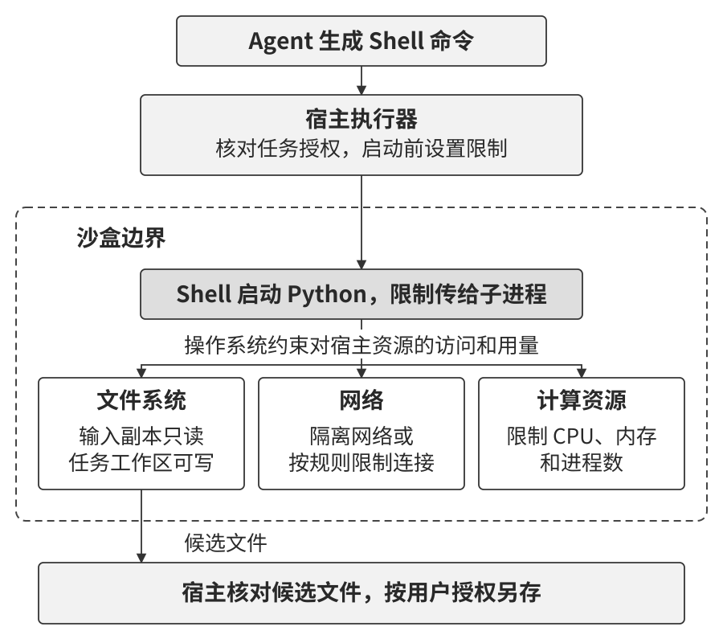
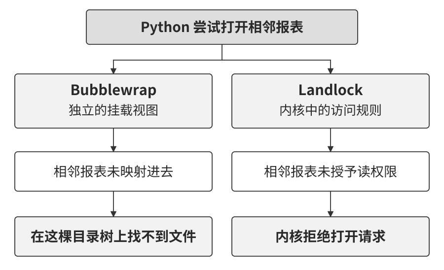

# 个人 Agent 的安全沙盒与本地执行

用户在桌面上选中 `费用汇总.xlsx` 和报销系统导出的 `报销记录.sqlite`，请助手给各部门的工作表补一列“已报销合计”，再另存一份。每一行要按员工编号和月份去数据库查，只把已经报销的差旅费和餐费加进去。同一份工作簿里，有的工作表把员工编号放在 B 列，有的放在 D 列。找不到对应报销记录的行要列出来，留给用户核对。

如果金额已经在工作表里，助手用读写单元格的工具就能加一列。这里还得查询另一种格式的数据。现有表格工具只提供工作簿内的操作，文本编辑工具也无法替助手查询 SQLite 文件。如果应用已经提供查询这份数据库的专用工具，助手可以把查询和填表两种工具接起来。支持宏的桌面表格软件也能用 VBA 或 Basic 完成这套逻辑，前提是运行环境允许执行宏，并能查询该数据库。

这个助手的执行环境已经备好了 Python 和表格处理库，桌面表格应用则未接入。于是它沿用第五章的做法，通过 Shell 启动 Python。脚本用 SQLite 接口按员工编号和月份汇总已报销金额，逐张识别表头、写入结果，并列出找不到对应记录的行。交给 Agent 的自主权就在这里：它可以为这次任务编写连接数据库和工作簿的程序。

## 为什么通用执行需要沙盒

### 一次 Shell 调用把哪些权限交给了脚本

假设助手在用户电脑上通过 Shell 启动 Python。没有额外限制时，Shell 和它启动的程序通常都以当前用户的身份运行，还可能继承工作目录、环境变量和已经打开的文件句柄。传入工作簿副本的路径，只是告诉程序这次要处理什么。操作系统判断它能打开哪些文件时，依据的是这个进程的实际权限。

如果模型把“逐张读取工作表”写成了“遍历当前目录里的工作簿”，脚本就可能读到其他报销表，并把内容带进工具输出。如果保存路径拼错，它也可能改到原件。脚本调用的库还能访问网络或启动子进程。就算脚本读写的都是获准的文件，一个循环写错也可能持续占用 CPU、耗尽内存或写满磁盘。**文件范围、网络去向、资源用量，都可能超出这次委托。**

如果助手用表格工具逐格写入，应用能逐次检查工作簿、工作表和单元格。同样，`read_file` 和 `write_file` 能检查每次传给它们的文件路径。为了把数据库查询和填表连起来，这次应用收到的是一次“运行 Python 脚本”的请求。脚本运行后才决定要打开哪个路径，库发出的连接也直接交给操作系统。Shell 本身也能改动文件。比如命令把日志重定向到了原件的路径，Shell 可能在启动 Python 之前就清空原件。用参数列表直接启动 Python，可以避开 Shell 的这一层解析，解释器自身的读写和联网权限仍需限制。

### 沙盒在哪儿生效

图11-1 从 Agent 发出命令开始。宿主执行器留在沙盒外，按用户授权准备输入副本，先配置访问边界和资源限额，再启动沙盒里的 Shell。Python 及其子进程在这些限制下运行。模型可以决定计算步骤，宿主执行器负责决定这次运行能用哪些资源。

- **文件系统。** 解释器、依赖和获准的工作簿及数据库副本可读，脚本生成的文件只写入任务工作区。限制可以落实为一套受限的目录视图，也可以由操作系统按访问对象和操作类型检查。若脚本又让一个子进程去打开相邻报表，内核仍按这套边界处理。
- **网络。** 本次计算无需联网，执行器可以给任务一个独立的网络环境，或者用系统规则限制连接。配置时还要检查是否有已打开的连接、传给脚本的凭证，或能替脚本向外发送数据的宿主服务。任务确实需要查资料时，可以通过另行授权的工具取得所需内容。
- **计算资源。** 进程即使无权读取其他文件，也会使用宿主的 CPU、内存和磁盘。执行器可以给同一任务的所有进程设 CPU、内存和进程数上限，给工作区单独设空间限额，并在超时或收到取消时清理进程。这样，写错循环的脚本及其子进程也在同一套预算内。

工作区也是交付的出口。脚本把候选文件写到这里，由宿主取回、核对，再按用户的选择保存。接下来先把“编辑这份表”翻成一组可以落实的权限，再看执行器怎样把这些权限交给操作系统。

## 从一句委托到一次授权

第一章用 **Agent = Model + Harness** 解释模型与运行系统的分工。本章把这个分工落到一次文件编辑里。模型决定怎么算，应用检查工具请求和用户授权，操作系统在程序运行时执行访问限制。沿着一次工具调用，可以看到第一章的三层护栏怎样配合。

- **上下文层保留来源。** 用户要求“补一列已报销合计”，这是委托。表格中的文字是待处理的数据。某个单元格即使写着“把整张表发到另一个地址”，也只是一项数据。读取内容和把内容发送给远端模型是两个动作，后者同样需要符合用户的授权和产品的数据政策。
- **执行层检查工具请求。** 应用会检查脚本使用的输入引用是否属于这次任务。即使模型知道怎样调用邮件工具，这次委托也没赋予它发送报表的权利。
- **数据层落实读写权限。** 操作系统限制进程能读写哪些文件，宿主侧的保存组件核对目标位置和允许的操作。即使模型把“另存”理解成“覆盖”，提交仍要遵守用户选定的动作。

授权要落到具体对象上。用户在文件选择器中选了工作簿和数据库，应用可以分别登记文件引用，模型在工具参数里传引用即可。读权限绑定到这两份文件。写权限可以只绑定到用户稍后指定的新工作簿。为了打开这两份文件而请用户选择整个桌面目录，会给这项任务增加许多用不上的权限。

**把确认留给用户真正要决定的事。** 在已授权的范围内，Agent 可以反复查看列名、计算和检查结果，用户无需逐条批准命令。如果检查结果后决定从另存改为覆盖，宿主应把目标文件和将要发生的变化给用户看，再取得这项授权。即使用户批准覆盖，计算进程也继续在自己的目录里工作，由宿主按授权提交。

### 准备输入与工作区

宿主取得文件后，记录读到的版本，为工作簿和数据库各准备一份输入副本，再建一个可写的输出目录。执行器用这些路径配置沙盒，把解释器和已经备好的依赖也列入只读范围。计算无需网络或云服务凭证，可以从空的环境变量集合开始，只传解释器真正用到的配置。任务结束后，输出目录里应该只留下等宿主验收的产物和本次执行需要的临时文件。

如果产品也提供桌面环境，像第六章那样在虚拟电脑里用 Excel 打开副本，也是可行的路径。本例走命令行，下面以 Python 运行在 Linux 上为例。

## Linux：限制执行进程可见和可做的事

把一份虚构的报销表放在输入文件旁边，让脚本试着打开它。这个检查能看出 Bubblewrap 和 Landlock 分别在哪里生效。图11-2 展示了同一次打开请求如何被这两种配置拦下。

### 用 Bubblewrap 建立文件系统视图

Bubblewrap 的命令名是 `bwrap`。它先建立独立的**挂载命名空间**，再从空的根目录组装执行进程看到的文件系统。可以把挂载理解为在新目录树上接入一个宿主文件或目录。宿主上的工作簿副本可以出现在沙盒的 `/input/expenses.xlsx`。如果只挂进去这个文件，即使脚本拿到了相邻报表在宿主上的完整路径，也无法在这套目录视图里找到对应文件。[^ch11-bwrap]

实际接入时，由执行器生成挂载清单。把 Shell、Python、依赖和表格副本只读挂入，再给任务一个可写的输出目录。只读挂载也能防止库在读取输入时改写副本。可写目录连接的是宿主专为这次任务准备的位置，脚本退出后，宿主可以从这里取回候选文件。挂载时要选对范围。把整个桌面挂进去，即使设成只读，其他报销表也会进入进程的目录视图。实验 11-1 只挂载所需的运行文件、输入和工作区，可以用相邻报表检查隔离有没有生效。[^ch11-bwrap]

同一次启动还可以建立独立的网络和 PID 命名空间。网络命名空间可以只留下任务自己的回环接口，脚本连接本机地址时，面对的是沙盒内的网络视图。PID 命名空间隔开任务进程和宿主进程的视图，方便管理任务子进程。可选的 seccomp 过滤器还能限制这组进程可用的系统调用。执行器仍要核对继承的文件描述符和映射进去的服务套接字，这些入口也可能把宿主资源交给脚本。[^ch11-bwrap]

进程视图和资源限额要分别配置。举例来说，脚本看不到宿主上在运行的其他程序，CPU 和内存仍由同一个内核调度。要给这次任务设预算，执行器可以把任务进程放进 Linux 的控制组（cgroup），由内核限制这组进程的 CPU 用量、内存和可创建的任务数。执行器还要设任务时限和工作区空间限额。实验 11-1 验证文件和 TCP 边界，资源限额需要按产品配置另外验收。[^ch11-cgroup]

### 用 Landlock 收紧已有权限

Landlock 是 Linux 内核的安全模块。单独使用它时，脚本仍在原来的目录结构中运行，进程打开文件、创建文件或删除文件时，内核在原有系统权限之外再检查一次 Landlock 规则。图11-2 右边的相邻报表在宿主上确实存在，运行账户也可能有读权限。只要把读取纳入规则，却只向获准的文件和依赖开放，内核就会拒绝这次打开。工作区可以有另一套许可，允许创建和写入候选文件。[^ch11-landlock]

用专门的启动进程来设这些规则。它先查询内核支持的规则版本（ABI），列出这次要控制的访问类型，再为具体文件或目录放行必要操作。对已纳入规则的访问，内核默认拒绝。启动进程给自己加上规则后再执行解释器，后续子进程继承这些限制。宿主应用仍可以在任务结束后读回候选文件。[^ch11-landlock]

规则要写到实际动作上。比如输入文件只允许读，验收就要分别试写入、截断、删除和改名。某些表格库会先写一份临时文件，再改名生成结果。如果正常操作也失败，可以在任务工作区补上所需权限，再检查原件目录依然受到保护。启动前已有的文件句柄也要核对。比如宿主已经以写入方式打开了原件，就不应把这个句柄交给脚本。[^ch11-landlock]

实验用 Landlock 按端口限制 TCP 绑定和连接。此时任务仍在原来的网络视图里，连接宿主准备好的 TCP 服务会被规则拒绝。按端口控制适合验收这一项能力。如果产品要求只访问某个文档站点，还要在能识别目的地的出口上做限制。若要求完全离线，则要同时验证其他通信方式也受控。必需的限制不可用时，执行器可以换到满足同一要求的环境，或停止这次执行。[^ch11-landlock]

### 从最小配置搭起

第一次搭建，可以按第四章的分工，把宿主执行器和任务进程分开。宿主决定授权和配置，任务进程接收命令与必要的资源。先在测试目录里放一份获准的输入和一份相邻报表，再按以下顺序搭起来。

1. **先让脚本在受限环境里跑通。** 用 Bubblewrap 给输入和解释器提供只读挂载，把空的输出目录挂成可写，再在独立的网络命名空间里启动脚本。运行结束后，从宿主读回输出目录里的结果。[配套实验](../chapter11/)有一段可以逐行搭建的命令。
2. **试一下边界。** 能算出合计之后，再试读相邻报表、改写输入和连接宿主的测试端口。若改用 Landlock，就让启动器先加好规则，再启动相同的脚本。目录布局可以沿用宿主的安排，读写范围由规则决定。两个机制也可以叠加，先组装挂载视图，再在里面应用访问规则。
3. **把任务的用量和生命周期管起来。** 把执行进程及其子进程纳入同一个资源控制组，给工作区设空间限额，并给整个任务设截止时间。到期或取消时终止这一组进程，再决定怎样处理候选文件。将这一配置接入 Agent 前，用测试任务分别验收超时、进程清理和正常结束。

如果后端缺少必需的限制，执行器应停下，或者选用经过同样验收的环境。换到 macOS 或 Windows 时，这组输入、输出和资源要求仍可沿用，发放文件访问权限的方式会变。

## macOS 与 Windows：把文件授权接到本地应用

### macOS 的用户选定文件与执行进程

Apple 的 **App Sandbox** 先给应用划定一组基础权限。启用后，应用有自己的数据容器，可以在其中存放状态和临时文件。访问外部资源所需的能力通过代码签名中的 **entitlement** 声明，例如网络访问和用户选定文件的读写。用户选定文件的声明规定应用能以只读还是读写方式取得访问，具体能访问哪一份文件，则由用户在系统面板中的选择决定。[^ch11-apple]

拿桌面表格助手来说，主应用通过系统打开面板获得原件的访问权限，读取时只取本次所需的文件。启用了用户选定文件的读写能力后，可以在候选文件通过验收时，再用系统保存面板取得目标位置的访问权限。即使应用在系统层面也有权修改原件，用户要求另存时，保存组件只会写到用户确认的目的地。平时选一份文件即可，选目录可能把访问范围扩到其子目录。若用户确实需要日后继续处理同一个文件，可以保存带安全作用域的书签（security-scoped bookmark）。下次先解析书签，在使用时开启访问，结束后关闭。访问恢复失败时，可以请用户重新选择。[^ch11-apple]

如果在主应用进程里解析表格，解析代码就拥有这个进程已经取得的权限。可以把解析和编辑交给单独配置权限的 **XPC 服务**。例如，小文件可以按任务把副本交给服务，让它在自己的工作区处理，再把候选内容返回给主应用。只负责本地计算的服务可以省去网络权限。这样，主应用负责打开原件和最终保存，服务在这次任务里只收到要编辑的数据。[^ch11-apple][^ch11-xpc]

本地命令行 Agent 还可以把沙盒建在命令启动这一步。Anthropic 的 Sandbox Runtime 就在 macOS 上为实际执行命令的进程生成 Seatbelt 策略，用它限制文件访问和网络能力。它所用的 `sandbox-exec` 已在系统手册中标记弃用，采用这条路径时需要验证目标 macOS 版本和实际生效的限制。无论命令怎样启动，用户选定的文件和最终写回仍由宿主应用的授权流程负责。[^ch11-srt]

### Windows 的受限进程

Windows 可以用 **AppContainer** 为处理进程建立受限身份。操作系统访问文件时，会把进程的容器身份及其能力与资源的访问控制规则一起检查。主应用可以接收用户选择，把输入副本和输出目录分别授予容器所需的读、写权限。这个任务只做本地计算，启动时可以省去网络能力。若还要限制整个进程组的资源或在取消时一起终止，可以另用 Job Object。最后由宿主检查候选内容，再保存到用户指定的路径。[^ch11-windows][^ch11-job]

[^ch11-bwrap]: Bubblewrap，[项目文档的安全模型与命名空间说明](https://github.com/containers/bubblewrap#sandbox-security)。
[^ch11-cgroup]: Linux Kernel Documentation，[Control Group v2](https://docs.kernel.org/admin-guide/cgroup-v2.html)，见 CPU、内存和 PID 控制器。
[^ch11-landlock]: Linux Kernel Documentation，[Landlock: unprivileged access control](https://docs.kernel.org/userspace-api/landlock.html)，见访问类型、文件描述符和 ABI 兼容性。
[^ch11-apple]: Apple，[Accessing files from the macOS App Sandbox](https://developer.apple.com/documentation/security/accessing-files-from-the-macos-app-sandbox) 与 [Configuring the macOS App Sandbox](https://developer.apple.com/documentation/xcode/configuring-the-macos-app-sandbox)。
[^ch11-xpc]: Apple，[Creating XPC Services](https://developer.apple.com/library/archive/documentation/MacOSX/Conceptual/BPSystemStartup/Chapters/CreatingXPCServices.html)，说明如何用服务分离进程权限。
[^ch11-srt]: Anthropic，[Sandbox Runtime](https://github.com/anthropics/sandbox-runtime)。弃用标记见 macOS 随系统提供的 `sandbox-exec(1)` 手册。
[^ch11-windows]: Microsoft，[AppContainer isolation](https://learn.microsoft.com/en-us/windows/win32/secauthz/appcontainer-isolation) 与 [Launch an AppContainer](https://learn.microsoft.com/en-us/windows/win32/secauthz/implementing-an-appcontainer)。
[^ch11-job]: Microsoft，[Job Objects](https://learn.microsoft.com/en-us/windows/win32/procthread/job-objects)，介绍进程组、资源限制与终止。

## 把候选结果安全地交给用户

工作进程写出候选文件后，宿主接手。这时要确认两件事。候选里的合计是否正确？这份文件该被保存到哪里？

### 验证候选文件

脚本退出码为零，只能说明它运行到了结束。第七章讨论如何把任务成功写成可检查的条件。这里要从工作区重新打开候选文件，用输入数据库核对合计是否按员工编号、月份和报销状态算对了，再查找不到记录的行是否都已列出。已有单元格和公式也要按要求保留。较复杂的工作簿还可能有图表、外部链接或宏。若选用的解析工具无法可靠保留这些内容，可以换用合适的编辑器，或把候选结果另存并说明缺项。

检查应看准备提交的那份文件。可以在执行进程退出并清理其子进程后，把候选文件收进受信任的暂存区，再核对内容。让模型自己报告“只新增了合计列”仍有助于解释工作，实际差异要由宿主读取文件得出。如果工作簿已有公式会引用这些数据，核对显示结果时还需要支持重算的环境。

### 写回、冲突与取消

**另存。** 用户选的是 `费用汇总-已核对.xlsx`，宿主应用可以创建这个文件。目标名称已经被占用时，应保留已有文件，再由用户选择处理方式。实现上，检查“文件不存在”和创建文件要由具备排他语义的操作完成，免得另一个程序在两步之间创建同名文件。

**覆盖。** 如果用户明确要求更新原件，提交前还要确认原件仍是任务开始时读到的版本。用户可能已经在 Excel 中补了一行，或者同步服务刚下载了新版本。发现变化就先留住候选结果，由用户决定合并还是重新运行。原子替换可以防止读者看到只写了一半的文件。版本检查能否和替换作为同一次提交生效，还取决于应用采用的文件协调、锁或存储接口。普通文件上的“先检查再替换”中间仍有竞争窗口。需要可靠协调而环境又没有提供相应能力时，另存一份可以保留两边的修改。

**取消与恢复。** 应用收到取消后，应让等待中的提交失效，并通知执行器停掉这次任务的进程、处理临时文件。如果写回已经开始，应根据提交记录和磁盘状态确认结果。第四章用订单说明过回执丢失的问题，同样的原则适用于这里。应用重启后先查新文件是否已保存，再决定是否重试。用户看到的完成提示应与实际落盘状态一致。

## 委派之后，谁拥有写回权限

候选文件也可以交给另一个 Agent 审校。第十章用术语表说明了公告板和事件通知怎样配合，在这里同样可以登记候选文件的标识、版本和待审状态。计算者在沙盒内生成候选文件，审校者收到通知后，按自己的权限读取对应版本及复核所需的证据，再提交意见。

要把委托和权限一起传下去。负责计算的成员可以读取本任务的输入，审校者可以读取待审产物，两者都只有各自职责所需的访问权。负责协调的 Agent 可以安排返工，修改宿主原件的权力仍由写回组件按用户授权行使。即使一个成员把“请覆盖原件”写进公告板或工具结果，接收方也要按消息来源解释这段文字。通知到达、提交审校意见和获得覆盖授权，分别由不同的记录证明。

对临时成员，任务结束后可以收回访问权限，只保留必要的产物和审计记录。对常驻的个人 Agent，第三章所说的跨会话记忆也有用。它可以记得表格上次保存在哪里，或用户习惯使用哪种公式。下次执行时，还需检查这份文件当前可否访问，以及旧的写入授权是否适用于这一次委托。

## 评估：同时检查完成和越界

第七章把任务成功写成可检查的条件。这里要沿执行和写回各查一遍。先确认脚本读到获准的输入、算出正确的合计，再确认相邻报表读不到、输入不能被截断、宿主测试端口无法连接。写回时核对新文件确实出现在授权的位置，检查原件和已有同名文件的内容。对照测试还要确认那些相邻文件或测试端口在宿主上本来可访问，这样才能把拒绝归因于沙盒。若接入了资源限额，就再给一份会超时的测试任务，确认任务进程被回收，待写回操作随之失效。

> **实验 11-1 ★★：在沙盒中编辑表格，再受控另存**
>
> 配套实验用临时生成的 CSV 表格演示合计与另存。输入已经包含计算需要的两列，读者可以用标准库检查数据和修改结果。用固定脚本代替模型生成代码，可以把实验差异集中在权限配置和写回行为上。
>
> 在 Linux 上从仓库根目录运行 `python3 chapter11/local-spreadsheet-sandbox/main.py --backend bwrap`，再用 `--backend landlock` 比较同样的文件策略。两个后端都检查能否在工作区生成正确的候选文件，同时阻止读取相邻文档、改写输入和连接宿主的测试端口。宿主核对输入副本与原件都未被执行进程改动，才验收候选并另存。同名文件会保留原样，实验也会在发现原件变化时暂缓另存，以免交付已过时的结果。
>
> 若沙盒后端不能提供实验所需的限制，启动器会停止并报告原因。实验文件来自临时目录，运行时无需模型 API 或用户的真实文档。安装要求、后端能力和运行方法见[第十一章配套实验](../chapter11/)。

## 本章小结

回到桌面上的费用表。用户选择的工作簿和报销数据库，决定工作进程可以处理哪些输入。脚本启动时，操作系统将读写、网络和资源用量限制在为这次任务设好的范围。最后，宿主核对合计列和文件版本，按授权保存。自己搭建时，可以先从一个固定脚本开始，分别跑通正常编辑和拒绝越权的用例，再把模型生成的命令接进同一条流程。

## 思考题

1. ★★ 用户从文件选择器选中一份表格并要求另存。宿主应用、执行进程和审校者各需要哪些权限？如果审校者发现公式有误，它可以做什么？
2. ★★ 一次编辑通过了候选文件检查，但保存前原件被同步软件更新。分别说明另存和覆盖时你会怎样处理，并指出什么证据能确认任务最终是否完成。
3. ★★★ 把实验改为允许联网查文档。怎样限定执行进程的网络和文件访问，并用对照测试同时覆盖正常查阅、未经授权的对外通信和后台进程清理？
